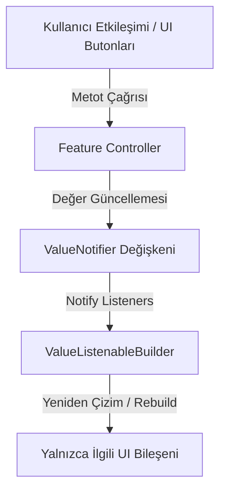

# State Flow Mimarisi (ValueNotifier)

Bu doküman, projede kullanılan `ValueNotifier` tabanlı durum akışını ve reaktif haberleşme şemasını tanımlar.

## İlkeler
1. **İzolasyon:** UI bileşenleri iş mantığını bilmez; yalnızca Controller üzerindeki metotları tetikler.
2. **Hafiflik:** Tüm ekran `setState()` ile yeniden çizilmez. Sadece değişen `ValueListenableBuilder` bloğu güncellenir.
3. **Bellek Yönetimi:** Controller `dispose()` metodu ile tüm `ValueNotifier` nesneleri temizlenir.
