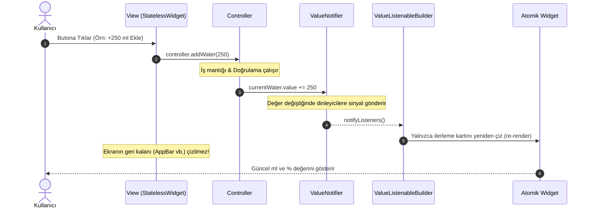
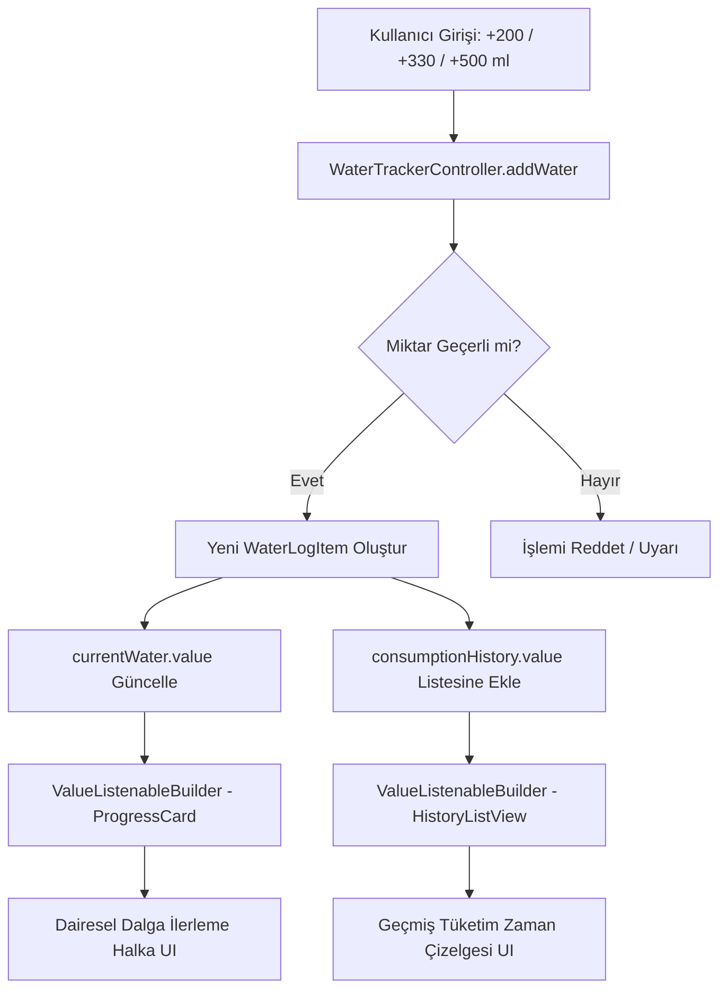
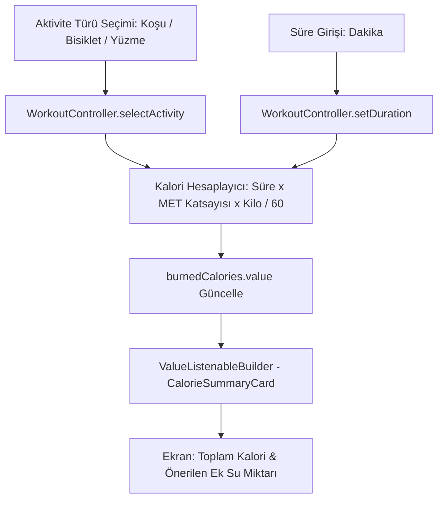

# Reaktif State Akışı ve Mimari Kılavuzu (`state_flow.md`)

Bu doküman, **Susadım v1** ve ilişkili Flutter feature mimarisinde uygulanan **ValueNotifier Reaktif Durum Yönetimi** (State Flow) mekanizmasını, bileşenler arası veri dolaşımını ve yaşam döngüsü kurallarını detaylandırmaktadır.

---

## 1. Mimari Genel Bakış

Geleneksel `setState` yaklaşımında tüm `StatefulWidget` ağacı yeniden çizilir. Karmaşık paketlerde (Bloc/Redux) ise yoğun boilerplate ve asenkron stream yönetimi gerekir. 

Projemizde benimsediğimiz **ValueNotifier** mimarisi:
- **Hafif ve Hızlıdır:** Saf Flutter SDK kütüphanesidir (`flutter/foundation.dart`), harici bağımlılık gerektirmez.
- **Hedefe Yöneliktir (Granular Re-render):** Yalnızca `ValueListenableBuilder` ile sarılmış atomik widget yeniden çizilir; ekranın geri kalanı sabit (`const`) kalır.
- **İş Mantığı İzolasyonu:** UI katmanı iş mantığından tamamen soyutlanmıştır.

---

## 2. Reaktif Döngü Mimarisi (State Flow Diagram)

Aşağıdaki Mermaid diyagramı, kullanıcı etkileşiminden atomik ekran güncellemesine kadar olan veri akışını özetlemektedir:



---

## 3. Modül Bazlı Durum Akışları

### A. Su Takip Modülü Durum Akışı (`WaterTracker`)



### B. Egzersiz ve Kalori Modülü Durum Akışı (`Workout`)



---

## 4. Yaşam Döngüsü ve Bellek Yönetimi (Lifecycle)

Controller nesneleri içerdikleri `ValueNotifier` örnekleri nedeniyle dinleyicileri bellek üzerinde tutar. Bellek sızıntılarını (memory leak) önlemek için aşağıdaki yaşam döngüsü kuralına istisnasız uyulmalıdır:

1. **Başlatma (`Init`):**
   Sayfa widget'ının `State.initState()` metodunda controller ilklendirilir.
2. **Kullanım (`Listen & Build`):**
   `View` katmanı `ValueListenableBuilder` ile yalnızca ilgili veriyi dinler.
3. **Kapatma (`Dispose`):**
   Sayfa widget'ının `State.dispose()` metodunda `controller.dispose()` çağrılır. Controller içindeki tüm `ValueNotifier.dispose()` çağrıları tetiklenir.

```dart
// Controller İçinde:
void dispose() {
  currentWater.dispose();
  historyList.dispose();
}

// State Sınıfı İçinde:
@override
void dispose() {
  _controller.dispose();
  super.dispose();
}
```

---

## 5. Çoklu Durumları Birleştirme (`Listenable.merge`)

Birden fazla bağımsız `ValueNotifier` aynı widget görünümünü etkiliyorsa, iç içe `ValueListenableBuilder` yazmak yerine `Listenable.merge` veya `AnimatedBuilder` kullanılır:

```dart
AnimatedBuilder(
  animation: Listenable.merge([
    controller.currentWater,
    controller.dailyGoal,
  ]),
  builder: (context, _) {
    final current = controller.currentWater.value;
    final goal = controller.dailyGoal.value;
    final ratio = (current / goal).clamp(0.0, 1.0);
    return WaterStatsWidget(current: current, goal: goal, ratio: ratio);
  },
)
```

---

## 6. Sık Yapılan Hatalar (Anti-Patterns) ve Çözümleri

| Hatalı Yaklaşım (Anti-Pattern) | Doğru Yaklaşım (Best Practice) |
| :--- | :--- |
| `build()` metodu içerisinde her çizimde yeni `Controller` oluşturmak | `initState` içinde bir defa oluşturmak veya Dependency Injection ile almak |
| Sayfa kapatılırken `controller.dispose()` çağırmayı unutmak | `dispose()` çağrısını garantiye almak |
| `ValueListenableBuilder`'ı tüm `Scaffold`'un tepesine koyarak tüm sayfayı gereksiz çizdirmek | Yalnızca değeri kullanan küçük atomik bileşeni `ValueListenableBuilder` ile sarmak |
| Controller içinde `BuildContext` saklamak | Controller katmanını saf Dart olarak tutmak, UI bağımlılıklarını izole etmek |
| Model nesnelerini `mutable` yapıp doğrudan alanlarını değiştirmek | Modelleri `immutable` tutup `copyWith` ile yeni kopya üretmek |
