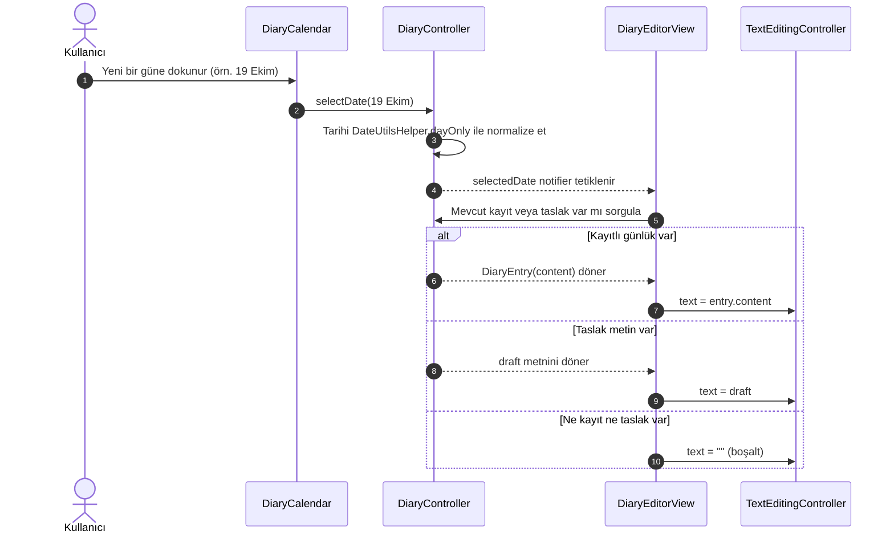
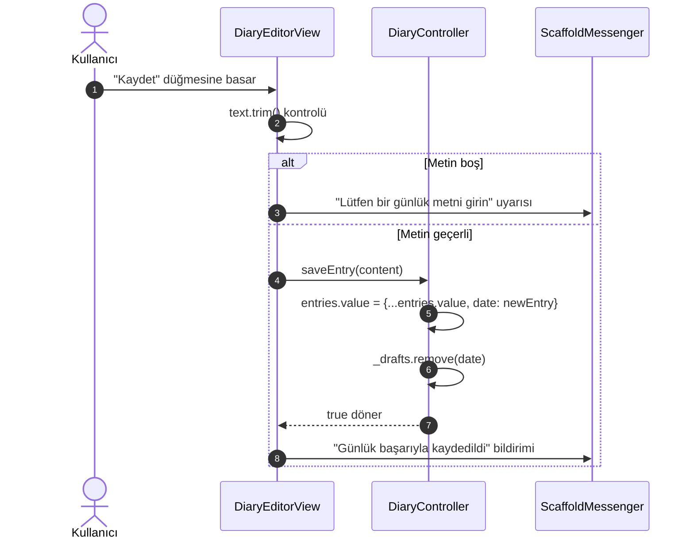
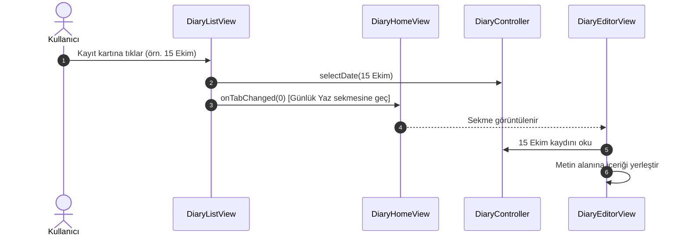
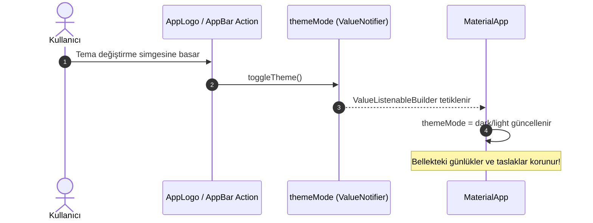

# Durum Akışı ve Yaşam Döngüsü Kılavuzu (State Flow Reference)

Bu belge, **Günlüğüm** uygulamasındaki durum yönetimi (state management) mimarisini, veri akışını, yaşam döngüsü kurallarını ve durum bileşenleri arasındaki etkileşimleri detaylandırır.

---

## 1. Mimari Genel Bakış

Uygulama, harici bir durum yönetimi kütüphanesi (Bloc, Riverpod vb.) veya kalıcı veritabanı olmaksızın, tamamen Flutter'ın yerleşik **`ValueNotifier`** ve **`ValueListenableBuilder`** sınıfları üzerine kurulmuştur.

Tüm veriler yalnızca bellek üzerinde (`in-memory`) tutulur ve uygulamanın yaşam döngüsü boyunca korunur.

```
+-----------------------------------------------------------+
|                          App                              |
|  - themeMode (ValueNotifier<ThemeMode>)                   |
|  - diaryController (DiaryController)                      |
+-----------------------------+-----------------------------+
                              |
                              v
+-----------------------------------------------------------+
|                      DiaryHomeView                        |
|  - currentTabIndex (0: Günlük Yaz, 1: Günlüklerim)        |
+-------------------+-------------------+-------------------+
                    |                   |
                    v                   v
+---------------------------+   +---------------------------+
|     DiaryEditorView       |   |      DiaryListView        |
|  - Takvim & Yazma Alanı   |   |  - Sıralı Kayıt Listesi   |
|  - TextEditingController  |   |  - Öğe Tıklama ile Geçiş  |
+---------------------------+   +---------------------------+
```

---

## 2. Durum Sahipleri ve Kapsam (Scope & Lifetimes)

### 2.1. Kök Düzey (App / MaterialApp)
- **`themeMode` (`ValueNotifier<ThemeMode>`):**
  - Başlangıç değeri: `ThemeMode.light`.
  - `toggleTheme()` çağrısıyla `ThemeMode.light` ve `ThemeMode.dark` arasında geçiş yapar.
  - `MaterialApp` widget'ını saran `ValueListenableBuilder` tarafından dinlenir.
- **`diaryController` (`DiaryController`):**
  - Kök widget'ın `initState` metodunda **yalnızca bir kez** oluşturulur.
  - Alt widget'lara parametre (constructor injection) yoluyla aktarılır.
  - Kök widget'ın `dispose` metodunda kapatılır.

### 2.2. Denetleyici Düzeyi (`DiaryController`)
Denetleyici aşağıdaki reaktif durumları ve yardımcıları barındırır:

| Değişken / Metot | Tip | Açıklama |
| :--- | :--- | :--- |
| `selectedDate` | `ValueNotifier<DateTime>` | Aktif olarak seçili olan gün (saat sıfırlı). |
| `entries` | `ValueNotifier<Map<DateTime, DiaryEntry>>` | Tarih anahtarlı kayıtlı günlükler haritası. |
| `_drafts` | `Map<DateTime, String>` | Kaydedilmemiş taslak metinlerin bellek içi havuzu. |
| `selectDate(DateTime date)` | `void` | Seçili tarihi günceller (`dayOnly` uygulanır). |
| `saveEntry(String content)` | `bool` | Seçili tarihe günlüğü kaydeder, taslağı temizler. |
| `getEntry(DateTime date)` | `DiaryEntry?` | Verilen tarihteki kayıtlı günlüğü döner. |
| `updateDraft(DateTime date, String text)` | `void` | Tarihe ait taslak metni günceller. |
| `getDraft(DateTime date)` | `String` | Tarihe ait taslak metni döner. |
| `dispose()` | `void` | Notifier nesnelerini serbest bırakır. |

---

## 3. Durum Akış Senaryoları (State Flow Scenarios)

### 3.1. Tarih Seçimi ve Metin Yükleme Akışı

Kullanıcı takvimden farklı bir güne dokunduğunda:



### 3.2. Günlük Kaydetme Akışı

Kullanıcı metni yazıp "Kaydet" düğmesine bastığında:



### 3.3. Günlüklerim Listesinden Düzenleyiciye Geçiş

Kullanıcı listedeki bir kayda bastığında:



### 3.4. Tema Değiştirme Akışı



---

## 4. Veri Bütünlüğü ve İnvaryant Kuralları

1. **Zaman Damgası Normalizasyonu (`DateUtilsHelper.dayOnly`):**
   - Dart `DateTime` nesneleri saat, dakika, saniye ve milisaniye bilgisi içerir.
   - İki tarihin Map anahtarı olarak eşit sayılabilmesi için `DateTime(year, month, day)` biçimine indirgenmesi şarttır.
2. **Değişmezlik (Immutability):**
   - `entries.value` güncellenirken harita yerinde değiştirilmemeli (`mutate`), spread operatörü ile yeni bir kopya oluşturulmalıdır:
     ```dart
     entries.value = {
       ...entries.value,
       date: DiaryEntry(date: date, content: text),
     };
     ```
   - Böylece `ValueNotifier` dinleyicileri referans değişimini algılar ve arayüz anında güncellenir.
3. **Bellek Taslağı Koruması (Draft Preservation):**
   - Kullanıcı bir metin yazarken tarihi değiştirirse veya sekmeler arasında gezinirse yazılan metin kaybolmamalıdır.
   - `TextField`'ın `onChanged` geri çağrımında veya tarih değişmeden hemen önce metin `_drafts[currentDate]` içinde saklanmalıdır.

---

## 5. Kaçınılması Gereken Hatalar (Anti-Patterns)

- **`build()` içinde Controller Üretmek:** Her ekran çiziminde yeni bir `DiaryController` örneği oluşturmak tüm bellek verisinin sıfırlanmasına neden olur.
- **`dispose()` İhmali:** `ValueNotifier` ve `TextEditingController` dinleyicilerinin serbest bırakılmaması bellek sızıntısına (memory leak) yol açar.
- **Doğrudan `SharedPreferences` veya Dosya Çağrısı:** Proje prensibi gereği kalıcı depolama yapıları kesinlikle kullanılmamalıdır.
- **Tarih Saat Farklılıkları:** `DateTime.now()` doğrudan anahtar olarak kullanılırsa her saniye farklı bir anahtar oluşur ve kayıtlar eşleşmez. Mutlaka `dayOnly` kullanılmalıdır.
